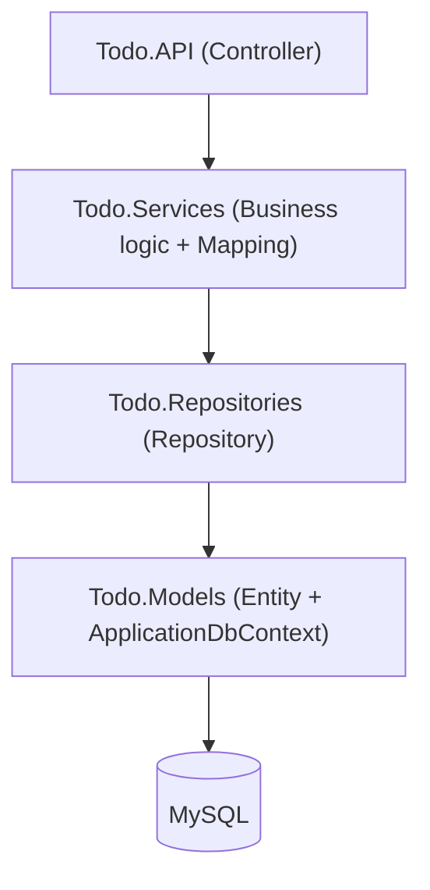
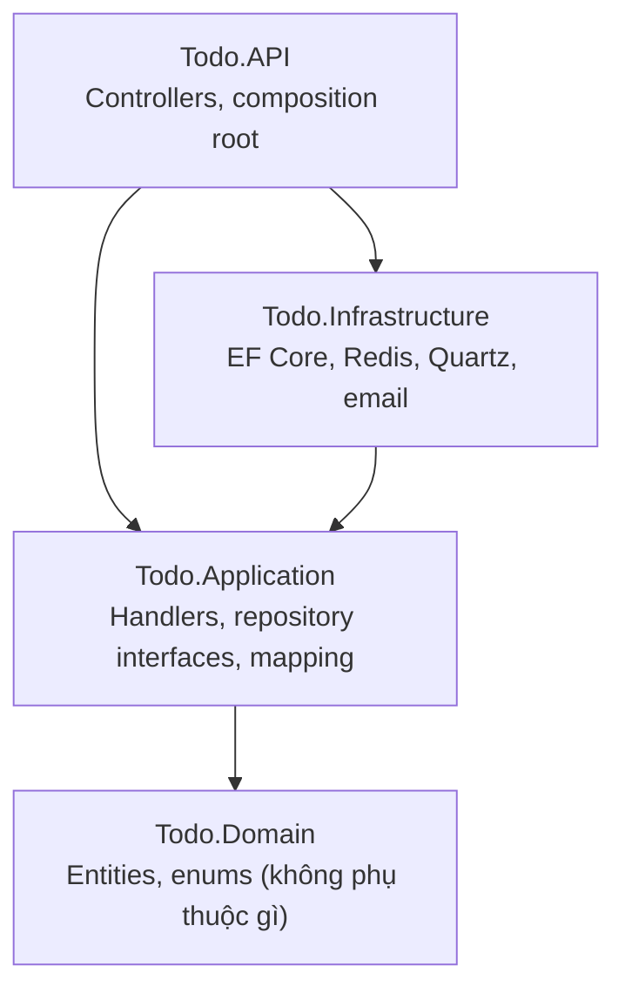

# Architecture

Từ Repository Pattern thuần sang Clean Architecture (CQRS-style handlers).

## 1. Thiết kế cũ: Repository Pattern thuần

Đặc điểm: 1 Controller → 1 Service → 1 Repository, thẳng hàng. `Todo.Models` gộp chung Entity + DbContext + Migrations, và Repository trả về entity thô. Vì vậy business logic vẫn "thấy" được kiểu EF, không có ranh giới rõ giữa "biết nghiệp vụ" và "biết công nghệ".

## 2. Thiết kế mới: Clean Architecture

Mũi tên là hướng **phụ thuộc** (project reference), luôn trỏ vào trong:

Trong `Todo.Application`:

- `Interfaces/*Handler`: mỗi use-case một interface, ví dụ `ICreateTodoItemHandler`.
- `Implementations/*Handler`: CQRS-style, mỗi handler làm đúng một việc.
- `Interfaces/Repositories`: ví dụ `ITodoItemRepository`, hướng domain, không biết EF.
- `Mapping`: AutoMapper profile.

`Todo.Infrastructure` implement các interface đó (repository bằng EF Core, `ICacheService` bằng Redis, jobs bằng Quartz). `Todo.API` là nơi duy nhất gắn interface với implementation cụ thể qua DI.

## 3. So sánh

| Tiêu chí | Cũ (Repository Pattern) | Mới (Clean Architecture) |
|---|---|---|
| Số lớp | 4 (API, Services, Repositories, Models) | API, Application, Infrastructure, Domain (DTOs tách riêng) |
| Business logic | 1 class lớn ôm hết CRUD | Mỗi use-case một Handler riêng, SRP rõ |
| Entity | Nằm chung `Todo.Models` với DbContext | Tách hẳn `Todo.Domain`, không biết EF tồn tại |
| Ranh giới công nghệ | Mờ, Service có thể đụng EF trực tiếp | Rõ, chỉ `Todo.Infrastructure` được đụng DbContext |
| Test | Khó mock vì Service phụ thuộc Repository cụ thể | Dễ mock vì Handler chỉ phụ thuộc interface (xem `Todo.Application.Tests`) |
| Thêm feature mới (Redis cache, Quartz job) | Phải chèn vào Service có sẵn, dễ phình to | Thêm Handler/Interface mới, không đụng code cũ |

## 4. Lý do chuyển

Không phải để "cho đẹp". Service cũ ôm quá nhiều trách nhiệm trong một class: khi thêm report, job, cache vào thì Service phình to không kiểm soát. Handler kiểu CQRS ép mỗi use-case đứng riêng, review cũng dễ hơn vì diff chỉ nằm trong một file nhỏ.

## 5. Quy tắc cần giữ

- Request flow: Controller → Handler → Repository, không nhảy cách tầng.
- Repository interface nằm ở `Todo.Application/Interfaces/Repositories/`, implementation ở `Todo.Infrastructure/Persistence/Repositories/`. Interface không được chứa kiểu EF (`DbSet<T>`, `IQueryable`).
- Không gọi DbContext bên ngoài `Todo.Infrastructure/Persistence/`.

Kiểm tra nhanh: nếu đổi MySQL sang cơ sở dữ liệu khác mà phải sửa ngoài `Todo.Infrastructure`, nghĩa là đang vi phạm quy tắc phụ thuộc.
