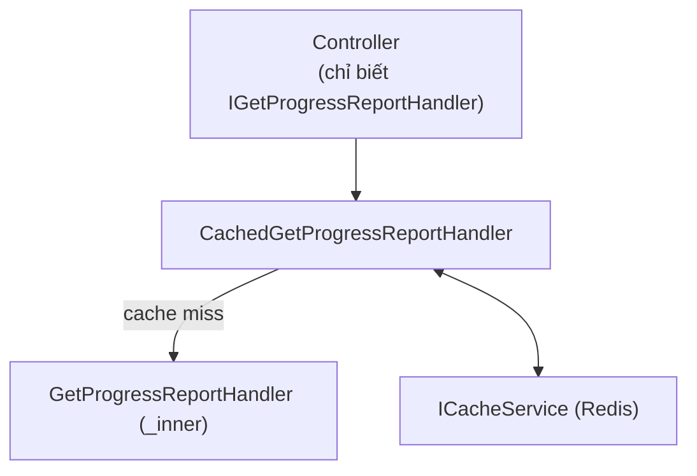

# Cache (Redis) và Decorator Pattern

## Vấn đề

`GetProgressReportHandler` tính report bằng cách quét DB, tốn kém, trong khi dữ liệu không đổi liên tục (report theo ngày).

## Vì sao không viết cache thẳng trong handler

Nếu viết logic cache (`GetAsync` → miss → tính → `SetAsync`) ngay trong `GetProgressReportHandler`, class đó vừa lo business vừa lo caching. Vi phạm SRP, và khó tắt cache khi test.

## Giải pháp: Decorator Pattern

`CachedGetProgressReportHandler` implement cùng interface `IGetProgressReportHandler`, bọc bên ngoài handler gốc:



DI wiring (`Todo.Application/DependencyInjection.cs`):

```csharp
services.AddScoped<GetProgressReportHandler>();
services.AddScoped<IGetProgressReportHandler>(sp =>
    new CachedGetProgressReportHandler(
        sp.GetRequiredService<GetProgressReportHandler>(),
        sp.GetRequiredService<ICacheService>(),
        sp.GetRequiredService<ILogger<CachedGetProgressReportHandler>>()));
```

Đăng ký `GetProgressReportHandler` là class cụ thể, rồi đăng ký `IGetProgressReportHandler` là bản bọc lấy nó. Controller chỉ biết `IGetProgressReportHandler`, không biết có cache hay không.

Phải viết tay bằng lambda: nếu đăng ký kiểu `AddScoped<IGetProgressReportHandler, CachedGetProgressReportHandler>()`, constructor của `CachedGetProgressReportHandler` cần một `IGetProgressReportHandler` để làm `inner`, và DI lại tạo ra chính `CachedGetProgressReportHandler`, lặp vô hạn cho tới khi crash.

## Cache key

`report:progress:start:{date}:end:{date}`, dựng từ filter của request. TTL 30 phút.

## Đánh đổi

Thêm một class và DI phức tạp hơn. Đổi lại, handler gốc hoàn toàn không biết Redis tồn tại. Tắt hoặc đổi cơ chế cache (ví dụ sang `MemoryCacheService` có sẵn) chỉ cần đổi wiring ở DI, không đụng business logic.

## Bẫy

- `RemoveByPatternAsync` trong `RedisCacheService` dùng SCAN theo pattern để xoá hàng loạt key. Nếu quên invalidate sau thao tác tạo/sửa/xoá thì cache trả dữ liệu cũ mà không có lỗi nào báo ra, chỉ là stale data.
- `RedisCacheService` nuốt exception và trả `null`/`false` khi Redis lỗi (chỉ ghi log), nên app vẫn chạy khi mất Redis nhưng mọi request đều thành cache miss.

## Phạm vi hiện tại

Cache mới áp dụng cho report (`report:progress`). Các endpoint search của TodoItem chưa cache.
