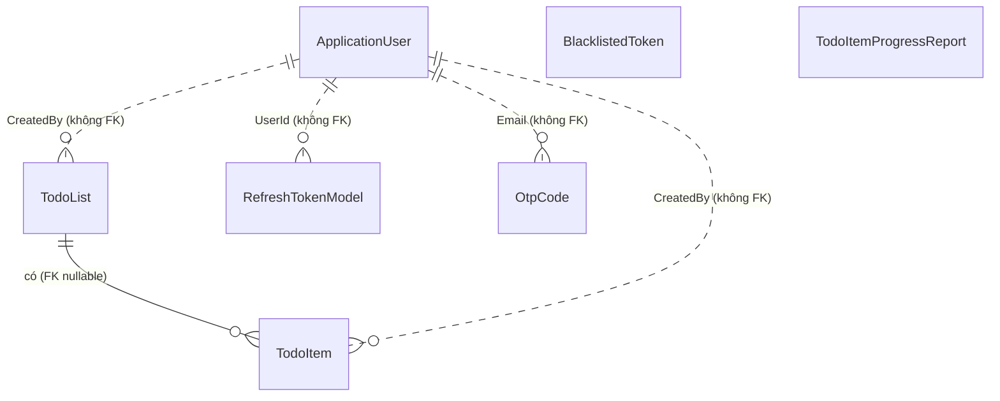

# Data model và quan hệ giữa các entity

## 1. Tổng quan



Nét liền là quan hệ có khoá ngoại thật trong DB. Nét đứt là quan hệ "mềm": hai bảng nối với nhau bằng giá trị nhưng DB không ép ràng buộc.

| Entity | Bảng | Thuộc | Ghi chú |
|---|---|---|---|
| `TodoList` | `TodoLists` | Domain | Danh sách công việc |
| `TodoItem` | `TodoItems` | Domain | Một công việc, thuộc tối đa một list |
| `TodoItemProgressReport` | `TodoItemProgressReports` | Domain | Snapshot số liệu theo ngày |
| `RefreshTokenModel` | `RefreshTokens` | Domain | Refresh token của user |
| `BlacklistedToken` | `BlacklistedTokens` | Domain | Token đã bị vô hiệu |
| `OtpCode` | `OtpCodes` | Domain | Mã OTP gửi qua email |
| `ApplicationUser` | bảng Identity | Infrastructure | Kế thừa `IdentityUser`, thêm `Role`, `LastLoginIp` |

## 2. Quan hệ có khoá ngoại: TodoList và TodoItem

Một `TodoList` có nhiều `TodoItem`; một `TodoItem` thuộc tối đa một `TodoList`.

```csharp
// TodoItemConfiguration.cs
builder.HasOne(x => x.TodoList)
    .WithMany(l => l.TodoItems)
    .HasForeignKey(x => x.TodoListId)
    .OnDelete(DeleteBehavior.SetNull);
```

Đọc từng dòng:

- `HasOne(x => x.TodoList)`: một `TodoItem` có một `TodoList` (navigation property trong `TodoItem`).
- `WithMany(l => l.TodoItems)`: phía ngược lại, một `TodoList` có nhiều `TodoItem`.
- `HasForeignKey(x => x.TodoListId)`: cột khoá ngoại nằm ở bảng `TodoItems`.
- `OnDelete(SetNull)`: nếu **dòng** `TodoList` bị xoá khỏi DB, các `TodoItem` liên quan không bị xoá theo mà `TodoListId` được đặt về `null`.

Hai phía trong Domain:

```csharp
public class TodoList : BaseEntity
{
    public ICollection<TodoItem>? TodoItems { get; set; }
}

public class TodoItem : BaseEntity
{
    public Guid? TodoListId { get; set; }   // nullable
    public TodoList? TodoList { get; set; }
}
```

Vì sao `TodoListId` nullable: một item có thể tồn tại độc lập, không bắt buộc nằm trong list.

Cấu hình quan hệ viết bằng Fluent API trong `Todo.Infrastructure/Persistence/Configurations/`, không dùng attribute trên entity, để `Todo.Domain` không phụ thuộc EF Core. `ApplicationDbContext` nạp tất cả bằng `ApplyConfigurationsFromAssembly`.

## 3. Quan hệ "mềm": nối bằng giá trị, không có FK

### 3.1. Quyền sở hữu qua `CreatedBy`

Mọi entity kế thừa `BaseEntity` đều có `CreatedBy` (string). Đó chính là Id của user tạo ra nó. Handler dùng nó để phân quyền:

```csharp
if (!user.Roles.Contains("SuperAdmin") && entity.CreatedBy != user.Id)
    return result.BuildError("Forbidden: you do not own this resource.");
```

Search cũng lọc theo `x.CreatedBy == ownerId`.

**Vì sao không phải `UserId` kèm navigation `User`:** `ApplicationUser` nằm ở `Todo.Infrastructure`, còn `Todo.Domain` không được tham chiếu gì cả (Dependency Rule, xem [ARCHITECTURE.md](ARCHITECTURE.md)). Domain không thể có `public ApplicationUser User` được, nên quyền sở hữu chỉ còn cách là một giá trị chuỗi.

### 3.2. Refresh token qua `UserId`

`RefreshTokenModel.UserId` là `Guid?`. `IdentityUser.Id` mặc định là `string`, nhưng Id do Identity sinh là chuỗi GUID, nên code chuyển qua lại bằng `Guid.Parse(user.Id)` và `tokenEntity.UserId.ToString()`. Không có `HasOne` nào cấu hình giữa hai bảng này, kết nối chỉ dựa vào quy ước đó.

### 3.3. OTP qua `Email`

`OtpCode` nối với user bằng `Email` (tối đa 256 ký tự), không phải Id. Hợp lý vì OTP được gửi và xác minh trước khi user có thể đăng nhập, kể cả trong luồng đăng ký.

## 4. Entity đứng một mình

- **`BlacklistedToken`**: chỉ có `Token` (tối đa 500 ký tự) và `ExpiresAt`. Chỉ cần tra "token này có bị chặn không", không cần liên kết với user.
- **`TodoItemProgressReport`**: là bản **chụp nhanh** số liệu của một ngày (`TotalTasks`, `CompletedTasks`, `CompletionRate`, ...). Cố tình không có FK tới `TodoItem`: report phải giữ nguyên số liệu của ngày đó dù item sau này bị sửa hoặc xoá.

## 5. `BaseEntity`: phần chung của mọi entity

| Trường | Dùng để |
|---|---|
| `Id` (`Guid`) | Khoá chính |
| `CreatedOn`, `CreatedBy` | Thời điểm và người tạo (`SetCreatedInfo`) |
| `ModifiedOn`, `ModifiedBy` | Thời điểm và người sửa gần nhất (`SetModifiedInfo`) |
| `IsDeleted` | Cờ xoá mềm, mặc định `false` |

## 6. Đánh đổi và bẫy

- **`SetNull` không bao giờ kích hoạt qua API.** Handler xoá list không xoá dòng, mà chỉ đặt `entity.IsDeleted = true` rồi `UpdateAsync`. DB không thấy dòng nào bị xoá nên `OnDelete(SetNull)` không chạy. Hệ quả: các `TodoItem` vẫn trỏ tới một `TodoList` đã đánh dấu xoá. Đây là chuyện cần xử lý (hoặc cố ý chấp nhận) ở tầng truy vấn, không phải ở DB.
- **Không có FK cho `CreatedBy`**: DB không ngăn được dữ liệu trỏ tới user không tồn tại. Đổi lại Domain sạch, không phụ thuộc Identity.
- **`UserId` là `Guid?` còn `IdentityUser.Id` là `string`**: khớp nhờ quy ước, không phải nhờ DB. Nếu sau này Identity đổi cách sinh Id thì `Guid.Parse` sẽ lỗi.
- **Bảng report không đồng bộ ngược**: sửa hoặc xoá item không làm thay đổi snapshot cũ. Đây là chủ ý, nhưng cần nhớ khi đối chiếu số liệu.
